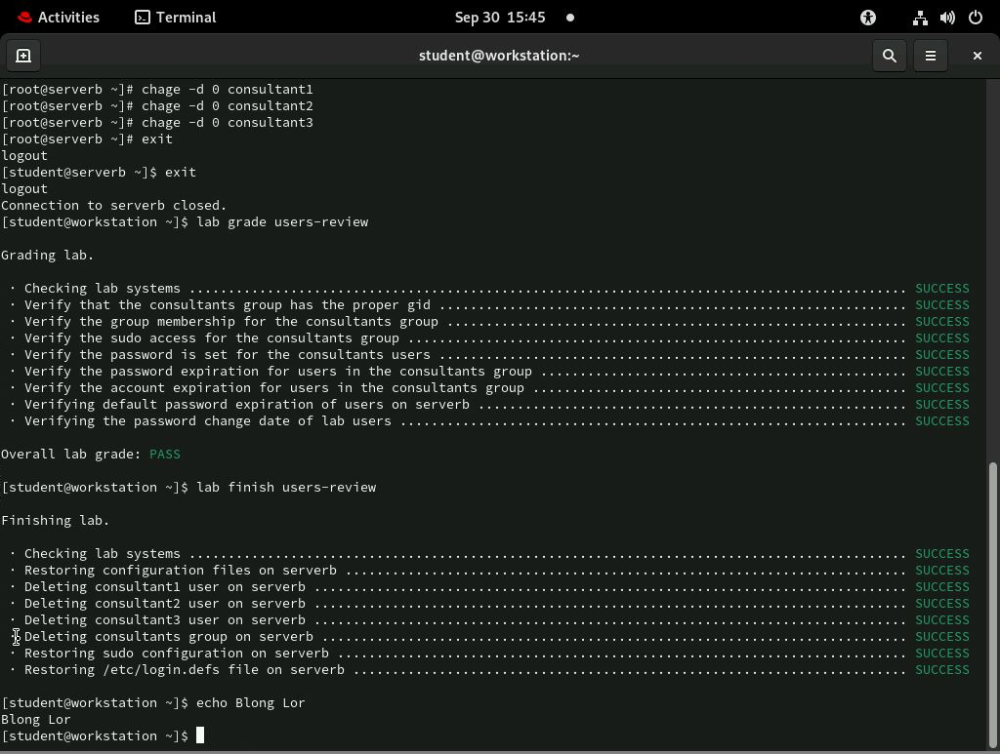
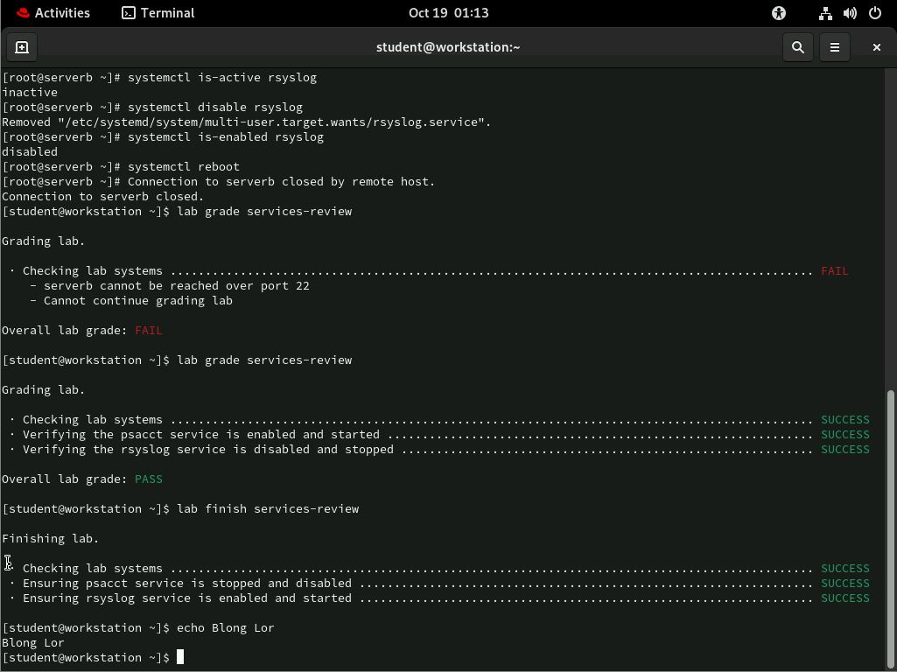
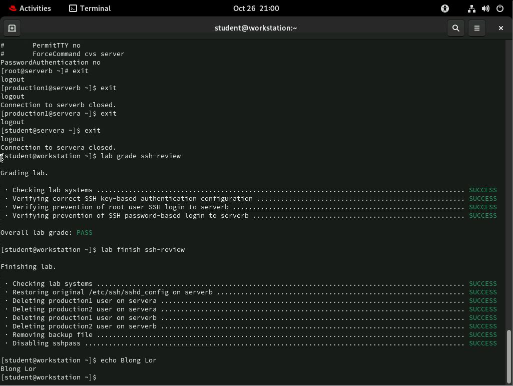
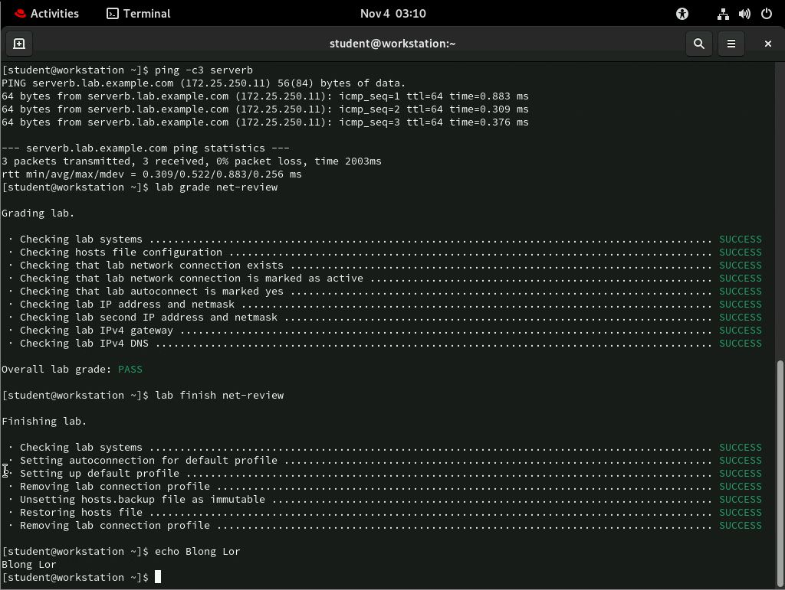
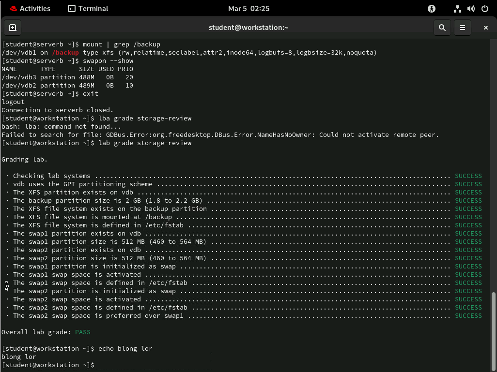
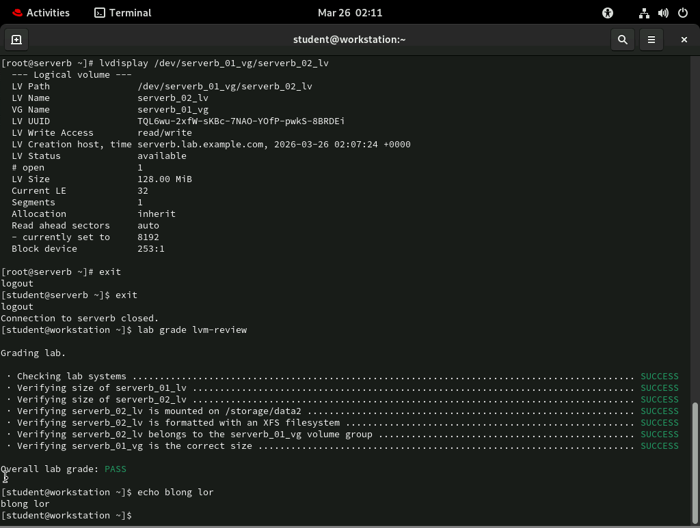
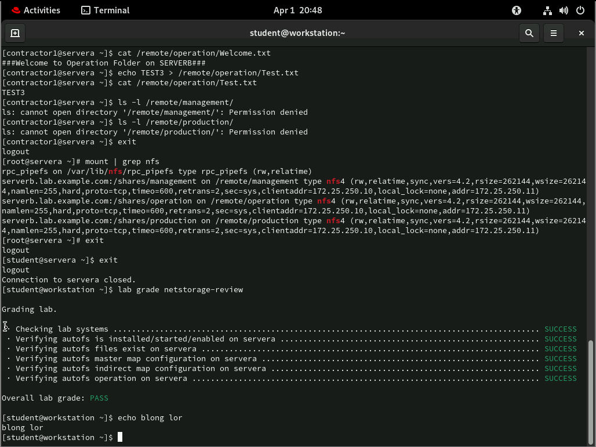
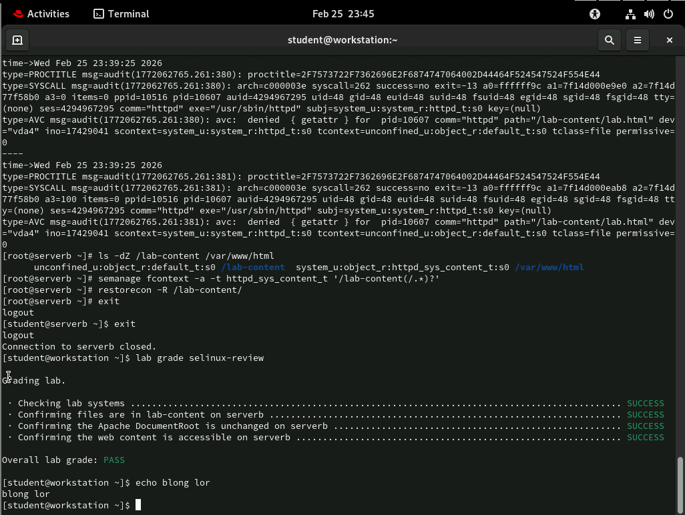
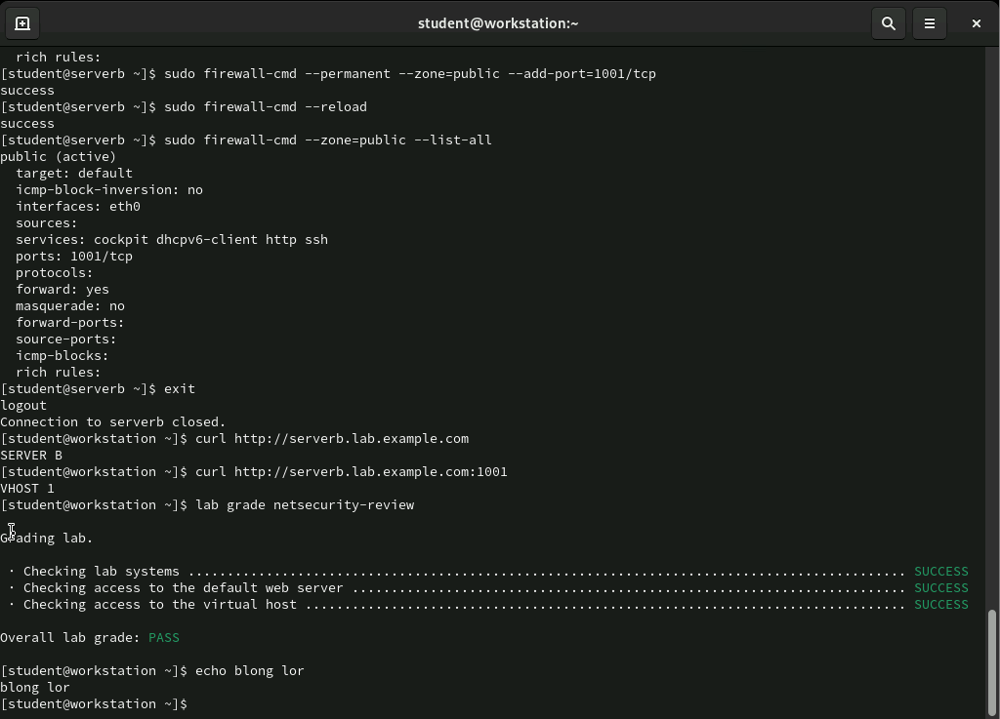

# Enterprise Linux Server Infrastructure - Dual-Tier Lab Workbook

## Coursework Overview
This comprehensive technical workbook details the core and advanced systems engineering milestones completed across Linux Administration 1 and 2 at Hennepin Technical College. All terminal labs were evaluated via an automated, production-grade grading rubric, verifying a perfect pass rating matrix under strict execution rules.

---

## ╔══ SECTION 1: SYSTEM ENVIRONMENT & INTERFACE SECURITY (LINUX 1)

### 1. Enterprise User Lifecycle & Identity Security
*   **Objective:** Provision administrative users, manage central security group footprints, configure elevated administrative sudo access, and enforce strict password/account aging matrices.
*   **Core Tasks:** Utilized `chage` parameters to manage password change compliance rules and audited systemic user group access structures across local nodes.

#### Verified Lab Readout:

---

### 2. Systemd Service Control & Daemon Management
*   **Objective:** Control operational states of background services, handle process accounting tracking daemons, disable insecure communication services, and analyze machine state persistence.
*   **Core Tasks:** Leveraged `systemctl` syntax switches (`is-active`, `disable`, `enable`) to enforce runtime configurations for the `psacct` and `rsyslog` service matrices.

#### Verified Lab Readout:

---

### 3. Secure Shell (SSH) Perimeter Hardening & Key Management
*   **Objective:** Secure server remote entry pipelines by disabling insecure access channels and enforcing robust cryptographic key-based user authentication.
*   **Core Tasks:** Modified systemic `/etc/ssh/sshd_config` attributes to enforce non-root remote authentication rules and disable password-based ssh login access vectors on the perimeter.

#### Verified Lab Readout:

---

### 4. Network Interface Architecture & Route Diagnostics
*   **Objective:** Configure systemic host files, ensure active interface auto-connection properties are marked true, verify static/dynamic IP netmasks, and audit upstream DNS and IPv4 gateway reachability.
*   **Core Tasks:** Executed ICMP packet diagnostic pipelines via `ping` and audited automated connection configurations across system connection profiles.

#### Verified Lab Readout:

---

## ╔══ SECTION 2: STORAGE CONFIGURATION, PERIMETERS & FIREWALLS (LINUX 2)

### 5. Multi-Disk Storage Layering & File System Blueprints
*   **Objective:** Provision GPT disk partitioning tables on block storage hardware, initialize independent swap spaces, determine priority queues, format robust XFS file systems, and enforce boot-persistent mounting points.
*   **Core Tasks:** Managed `/etc/fstab` configuration definitions and verified swap partition space distributions using `swapon --show` utilities.

#### Verified Lab Readout:

---

### 6. Dynamic Logical Volume Management (LVM Expansion)
*   **Objective:** Implement scalable enterprise block storage allocations by grouping physical volumes (PV) into unified volume groups (VG), cutting custom logical volumes (LV), and mapping dynamic mount directories.
*   **Core Tasks:** Executed `lvdisplay` schema audits to confirm layout geometries and verified runtime directory scaling allocations.

#### Verified Lab Readout:

---

### 7. Network-Attached Storage Targets (NFS & Autofs Engine)
*   **Objective:** Deconstruct shared file server architectures, map inbound Network File System (NFSv4) targets, and deploy `autofs` indirect automounting maps to eliminate local connection latency.
*   **Core Tasks:** Audited active network mounts via `mount | grep nfs` and validated auto-mounting directories under strict multi-tenant access block constraints.

#### Verified Lab Readout:

---

### 8. Kernel-Tier SELinux Security & Mandatory Access Control
*   **Objective:** Mitigate perimeter security vectors by enforcing Mandatory Access Control (MAC) policies, analyzing system AVC audit denial strings, and modifying file object contexts.
*   **Core Tasks:** Leveraged `semanage fcontext` matrices and `restorecon` scripts to restore system security targets over web server documents.

#### Verified Lab Readout:

---

### 9. Zone-Based Firewalling & Network Port Forwarding
*   **Objective:** Administer multi-zone stateful traffic perimeters, configure permanent interface rich rules, map virtual web hosts, and isolate specialized network ports.
*   **Core Tasks:** Commanded `firewall-cmd --permanent` properties to establish restricted custom TCP listener gates (Port `1001`) and verified end-to-end pathing using target `curl` string queries.

#### Verified Lab Readout:

