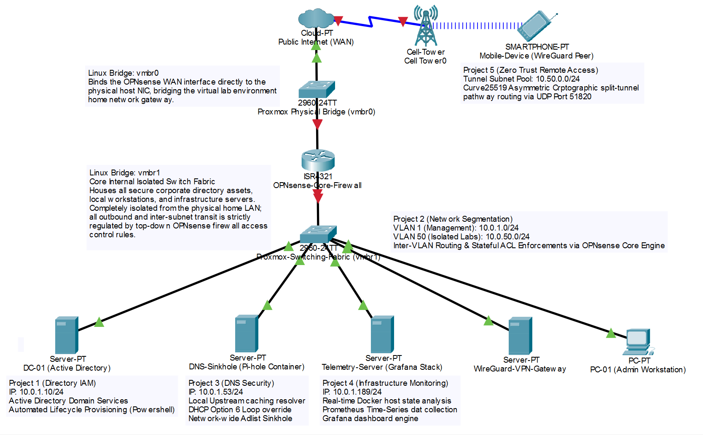

# Hennepin Technical College - Network Administration Academic Portfolio

## Degree Program Overview
This repository serves as a verified, comprehensive archive of laboratory deployments, configuration blueprints, and technical documentation executed throughout my Associate of Applied Science (AAS) in Network Administration degree program at Hennepin Technical College. This coursework validates my formal training across enterprise-tier routing fabrics, multi-OS server administration, hybrid cloud systems, infrastructure programming, and professional IT communications.

## Master Homelab Topology Blueprint
Below is the structural network design mapping all enterprise lab systems, virtual switches, and zero-trust security perimeters implemented across my portfolio:

---

## Core Coursework & Laboratory Milestones

### ╔══ Core Networking & Switching (CCNA Alignment)
#### Network Admin 1: Foundational Frameworks
*   **Core Competencies:** Designed custom VLSM IPv4/IPv6 addressing schemes, mapped data flows across the OSI and TCP/IP stack layers, and eliminated local connectivity drop-offs via initial router/switch terminal setups.
*   **Protocol Exposure:** Identified transmission media baselines and commonly used TCP/UDP destination ports.

#### Network Admin 2: Advanced Switching & Infrastructure Security
*   **Core Competencies:** Engineered virtual local area networks (802.1Q VLANs) with inter-VLAN routing across Layer 2 and Layer 3 switches. Implemented Spanning Tree Protocol (STP) topologies and EtherChannel link aggregation.
*   **Security & Reliability:** Deployed switch port security controls to mitigate local area network attack vectors, configured first-hop redundancy protocols, and built localized DHCP services for IPv4 and IPv6.

#### Network Admin 3: Dynamic Routing & Traffic Filtering (*In Progress*)
*   **Core Competencies:** Implementing single-area OSPFv2 protocols across point-to-point and multi-access networks. Configuring static/default routes, managing route aggregation, and building Enterprise WLAN deployments.
*   **Traffic Regulation:** Implementing standard, extended, and named Access Control Lists (ACLs) alongside Network Address Translation (NAT) methods on the edge router to enforce network security boundaries.

### ╔══ Windows Server & Cloud Identity Architecture
#### Windows Admin 1: Workstation Lifecycle & Local Security
*   **Core Competencies:** Installed workstation-level operating systems, handled user account management, mapped network printer resources, and enforced password controls.
*   **Access Control:** Configured local security groups, implemented system policies, and established secure remote connections via MS Remote Desktop. Managed file sharing via share permissions vs. local NTFS volume security.

#### Windows Admin 2: Active Directory Domain Services & Core Infra
*   **Core Competencies:** Promoted standalone servers to Active Directory Domain Controllers (AD DS). Managed directory-based user accounts and engineered nested local and global security groups.
*   **Enterprise Services:** Configured and delegated authoritative DHCP scopes, adjusted DNS parameters to link nodes to the campus network/internet, and deployed global Group Policy Objects (GPOs) across Domain and OU tiers.

#### Windows Admin 3: Hybrid Cloud Identity & Azure Infrastructure (*In Progress*)
*   **Core Competencies:** Administering Microsoft Entra ID (formerly Azure Active Directory) through the Azure web portal. Configuring user/group cloud profiles and implementing Role-Based Access Control (RBAC).
*   **Cloud Architecture:** Provisioning Azure compute resources, configuring virtual networking/inter-site connections, managing cloud storage architectures, running cloud backups, and deploying cloud containers.

### ╔══ Linux Systems Engineering & Containerization
#### Linux Admin 1: System Control & POSIX Foundations
*   **Core Competencies:** Navigating filesystem hierarchies via the command-line interface, manipulating user/group accounts, enforcing absolute/symbolic file permissions, and managing process priority thresholds.
*   **Daemon Tuning:** Controlling system services and daemons via systemctl, analyzing system log files to troubleshoot boot errors, configuring basic network resources, and maintaining remote connections.

#### Linux Admin 2: Advanced Storage & System Automation
*   **Core Competencies:** Managing disks, system partitions, Logical Volume Management (LVM) storage pools, and server file services. Automating installation passes and writing precise regular expressions (Regex) to parse text files.
*   **System Hardening:** Implementing advanced Linux Access Control Lists (ACLs), scheduling future automation tasks via cron daemons, and building local firewall security services.

#### Linux Admin 3: Enterprise Services & Infrastructure-as-Code (*In Progress*)
*   **Core Competencies:** Configuring and managing core network services including Domain Name System (DNS), DHCP, Lightweight Directory Access Protocol (LDAP), FTP, Mail, and Web hosting services.
*   **Automation & Virtualization:** Writing and executing advanced Bourne Again Shell (Bash) automation scripts, deploying Linux containers (LXC/Docker), spinning up virtual machines, and utilizing automation tools.

### ╔══ Hardware Diagnostic Systems & SOHO Operations
#### A+ Hardware Support
*   **Core Competencies:** Executing component-level personal computer (PC) hardware installations, troubleshooting motherboard/bus failures, managing hardware drivers, and resolving network cabling and printer issues.
*   **Virtualization & Scaling:** Building wired/wireless Small Office/Home Office (SOHO) networks, running hardware preventive maintenance cycles, and configuring client-side hypervisors and virtualization environments.

### ╔══ Applied Logic, Scripting & Technical Documentation
#### Fundamentals of Programming with Python
*   **Core Competencies:** Applying computational thinking concepts (abstraction, decomposition) to model procedural programs. Utilizing conditional boolean logic, iteration loops (`for`/`while`), arrays, stateless functions, and data structures.
*   **Quality Assurance:** Designing custom software test cases with strong data profiles, utilizing debugging methodologies, and studying object-oriented programming (OOP) techniques.

#### Technical Writing & Incident Logging
*   **Core Competencies:** Translating dense engineering data into high-clarity documents, including Standard Operating Procedures (SOPs), user instructions, technical descriptions, progress reports, and incident logs.
*   **Corporate Communication:** Structuring professional email strategies, integrating visual layout anchors for diverse audiences, and managing documentation lifecycles with absolute linguistic precision.
